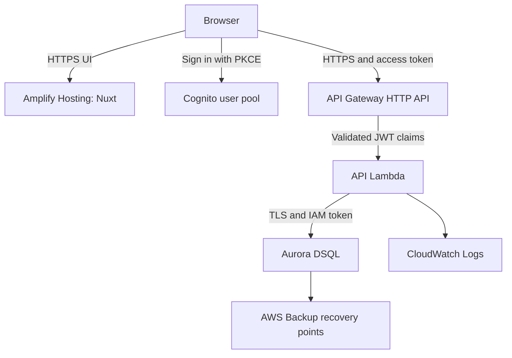

# AWS infrastructure specification

Status: development foundation deployed on 2026-10-10. See [deployment record](DEPLOYMENT.md) for verified scope; remaining product capabilities below are implementation requirements.
Date: 2026-10-10.

## Purpose and existing requirements

Host the Quotes application in the `quotes-development` AWS account. The application lets organizations manage configurable product taxonomies and save quotes with stable part numbers and prices.

The [product goals](../design/taxonomy/goal.md) and [taxonomy MVP specification](../design/taxonomy/specification.md) establish organization-owned taxonomies with ordered JSONB version snapshots, role-restricted editing, valid-only explicit saves, and attribution on every changed version. Sharing and history browsing are deferred. Future quote snapshots must survive taxonomy changes. The [API contract](../design/taxonomy/api-specification.md) and [plan](../tasks/3000/plan.md) describe this selected design; the taxonomy runtime and first-install SQL are implemented locally. See the [implementation record](../tasks/3000/implementation.md); live installation and deployment validation remain pending.

The code in `app/` now includes the identity and organization UI, with Cognito/HTTP adapters and local browser tests. `AWS/api/` implements the corresponding identity operations. See [task 1000](../tasks/1000/implementation.md) for validation and outstanding deployment, database-bootstrap, and email-worker dependencies; local implementation does not establish a working deployed product.

## Environment and proposed decisions

Amplify Hosting for Nuxt, API Gateway, an OpenAPI API definition, a Lambda API backend, Aurora DSQL, and three separate AWS accounts are confirmed requirements. Only development is in the current deployment scope. Other choices below remain proposals.

| Setting | Development baseline |
| --- | --- |
| AWS account | `quotes-development`; numeric account ID must be verified before deployment |
| Local CLI profile | `quotes-development` |
| Region | `us-west-2`, matching the existing CLI default |
| Infrastructure as code | Terraform, with committed provider lock file and pinned compatible versions |
| Frontend | AWS Amplify Hosting for Nuxt, with the Nitro Amplify adapter |
| API | API Gateway HTTP API, defined using OpenAPI 3.0, integrated with one Node.js Lambda |
| Database | Aurora DSQL single-Region cluster per environment |
| Authentication | Amazon Cognito public email/password signup with verified email; application-owned organization membership and roles |
| Public endpoints | Amplify HTTPS frontend and regional API Gateway HTTPS endpoint |
| Database connections | Direct PostgreSQL-wire connections to DSQL using IAM authentication and TLS |
| Release artifacts | Versioned private S3 deployment bucket |
| Database credentials | Short-lived IAM tokens; no stored database password |
| Logs and metrics | Amazon CloudWatch |

The frontend and API deploy independently. Amplify hosts the Nuxt UI using its Nitro adapter, preserving SSR capability without forcing `ssr: false`. Business operations remain in the separately deployed Lambda API. SSR is for rendering; Amplify has no database access role. Authenticated data can initially load in the browser after sign-in. Personalized HTML must never enter shared caches.

Aurora DSQL replaces the earlier RDS PostgreSQL proposal. It uses a PostgreSQL-compatible interface but requires compatibility checks against the existing logical data model. This document governs deployment and DSQL-specific behavior; the taxonomy document remains the business-model reference, not an executable DSQL migration.

## Account isolation and rollout

| Environment | Account | Rollout |
| --- | --- | --- |
| Development | `quotes-development` (`415221799122`) | First and only current deployment target |
| Staging | Separate AWS account; name and numeric ID to be supplied | Later; no resources or access changes now |
| Production | Separate AWS account; name and numeric ID to be supplied | Later; no resources or access changes now |

Reuse Terraform modules, OpenAPI, and application code with explicit per-environment inputs. Each account owns its Amplify app, API Gateway, Lambda versions/alias, DSQL cluster, Cognito pool/client, logs, backup vault/plan, deployment artifacts, IAM roles, budgets, and Terraform state bucket. Amplify branches or API stages do not substitute for account isolation. There is no cross-environment runtime database access, shared user pool, or implicit sharing of credentials/state.

Use independent root configurations and backends rather than Terraform workspaces as the account boundary. Every root must enforce its expected numeric account ID. Deployments select one environment explicitly; there is no default command applying all environments. Later CI federation must constrain each deployment role to its repository and environment, with protected production promotion. Promote tested code and API contracts; regenerate public frontend configuration for each account. Do not copy development data into production or production data into lower environments without a separate data-handling decision.

Account verification completed on 2026-10-10: account `415221799122` is named `quotes-development`; the `quotes-development` CLI profile now works. Before applying infrastructure, `aws sts get-caller-identity --profile quotes-development` must succeed and its account ID must match the intended account. Configure Terraform's allowed account IDs to prevent deployment into another account.

## Architecture



For development, run API and migration Lambdas without VPC attachment and connect to the DSQL public endpoint using verified TLS and IAM. The endpoint is network-reachable; IAM and database grants authorize connections. Do not describe this as a private database. There is no RDS instance, RDS Proxy, database password, NAT gateway, application VPC, or database security group in this baseline.

If staging/production require private network access, add a VPC and DSQL interface endpoints with endpoint/IAM policies before those deployments. AWS supports [PrivateLink for DSQL](https://docs.aws.amazon.com/aurora-dsql/latest/userguide/privatelink-managing-clusters.html). Do not create that network infrastructure in development without a requirement.

## Nuxt frontend on Amplify

- Create a dedicated Amplify app in the development account with an explicitly mapped source branch. Branch names and repository access remain deployment inputs; no branch names are assumed.
- The existing repository root is the local `app/` directory, so Amplify builds from repository root (no monorepo `appRoot`). Use locked dependencies, a supported Node build runtime, and the Nitro `aws-amplify` preset. Verify the installed Nuxt/Nitro output against the Amplify deployment contract.
- Commit the build configuration during implementation. Deploy the adapter's `.amplify-hosting` output, including its routing manifest, static assets, and compute bundle. See [Amplify's framework deployment specification](https://docs.aws.amazon.com/amplify/latest/userguide/ssr-deployment-specification.html).
- Amplify manages hosting, CDN delivery, HTTPS, and frontend releases. No independently managed S3/CloudFront frontend stack is needed.
- Initially use Amplify's generated HTTPS domain; custom domains are optional. Configure Cognito callbacks/logout and API CORS for the exact environment domain. Disable unconfigured branch previews by default so previews cannot accidentally use production APIs.
- Cache fingerprinted assets, and keep authenticated responses private/noncacheable. Test direct navigation, refresh, hydration, and missing assets using the generated routing configuration.
- Supply only public API URL and Cognito identifiers in browser-visible configuration. The Amplify build/service role has no DSQL connect or infrastructure deployment privileges.
- Generate the typed API client from OpenAPI. Do not add undocumented Nuxt business endpoints or direct database calls from frontend compute.
- Record Amplify job ID, source revision, and backend release in each release manifest. Amplify automatically rebuilds the connected `development` branch on Git pushes. Terraform, API releases, and migrations run locally for now. Deploy backward-compatible backend changes before pushing frontend changes that require them. GitHub Actions infrastructure automation is deferred.

## API Gateway and OpenAPI contract

Use API Gateway **HTTP API**, proposed for this development baseline, with OpenAPI **3.0** as the source of truth. HTTP API supports importing OpenAPI but does not enforce all schema/validation features. Validate request bodies, query/path parameters, and business rules in Lambda. If gateway-side request validation, API keys/usage plans, or other REST API-specific features become requirements, revisit the gateway type. See [AWS OpenAPI support for HTTP APIs](https://docs.aws.amazon.com/apigateway/latest/developerguide/http-api-open-api.html).

`AWS/openapi.yaml` defines the currently implemented routes, including health, session, identity, organization, and quote operations. Add taxonomy routes only during implementation, following these requirements:

- Explicit versioned business paths under `/v1`, unique operation IDs, request/response schemas, and status codes. Avoid a catch-all route that bypasses the declared API surface.
- Six taxonomy MVP operations: list owned active taxonomies, create, read current, save a complete version, preview, and archive. Do not add subscriptions, history-read endpoints, or a publishing workflow. Quote-line persistence remains separate work.
- Reusable error responses, decimal money represented as strings, IDs, pagination where needed, and conflict responses for stale taxonomy versions.
- Cognito JWT security for every business operation, with a required API scope to ensure access tokens are used. Only a minimal `GET /health` endpoint is public.
- AWS integration extensions (`x-amazon-apigateway-integration`) using `aws_proxy` and payload format `2.0`, targeting the published Lambda alias. Use a POST integration method regardless of the client's route method. See [Lambda proxy integration](https://docs.aws.amazon.com/apigateway/latest/developerguide/http-api-develop-integrations-lambda.html).
- Authorizer and CORS configuration using supported AWS extensions. Permit only the actual frontend origin and explicit localhost development origins, required methods, and the Authorization/Content-Type headers. Do not use wildcard origins for the authenticated app.

Render environment-specific integration ARNs, issuer, audience, and origins from infrastructure inputs. Terraform must import the rendered document as the API definition; do not independently create the same routes in separate Terraform resources. Fail deployment on import warnings or unsupported contract features. Lint the contract, check backward compatibility, generate client types, and test Lambda responses against the schemas. OpenAPI documents a contract; it does not implement the handler.

Allow API Gateway invocation only for this API's execution ARN and the intended Lambda alias. Do not enable a public Lambda Function URL. Configure explicit stage throttles, initially 10 requests/second with a burst of 20, and tune alongside Lambda/database capacity.

## Lambda API runtime

Use one Node.js Lambda for the initial business API, routing only documented method/path combinations. Keep it separate from the Amplify Nuxt build. Package a reproducible ZIP with a supported Node Lambda runtime, locked dependencies, and architecture-compatible database dependencies.

Start with 512 MiB memory, a 15-second function timeout, and a concurrency target of 10. The new development account has total concurrency 10 and cannot reserve that entire pool, so the deployed function uses unreserved concurrency until a quota increase permits an explicit reservation. Keep SQL, connection, and transaction timeouts below the function deadline; keep API work within the gateway's integration timeout. Long-running work will need a separate asynchronous design. No provisioned concurrency is required initially; measure cold-start behavior before paying to reduce it.

Publish immutable Lambda versions and point a `development` alias at the selected version. Keep configuration and release artifacts versioned. Reuse a small PostgreSQL pool across warm invocations, initially at most one connection per execution environment, and connect directly to DSQL with a compatible PostgreSQL driver/DSQL connector. Regenerate IAM authentication tokens when opening new connections; do not reuse an expired token as a permanent password. Release clients and roll back transactions on all error paths.

The handler must remain stateless across invocations. Validate trusted identity and organization authorization on every request, calculate prices server-side, and use transactions for taxonomy versions and quote snapshots. For taxonomy MVP operations, use `expectedVersionId` to reject stale saves and a single-attempt transaction path. Do not add idempotency keys, creation deduplication, mutation receipts, or automatic taxonomy retries. After an uncertain response the client reloads/reconciles; an uncertain create requires checking the catalog. Preserve other implemented services' retry behavior. Return safe errors with request IDs rather than database internals. `GET /health` exposes no secrets; run database readiness checks through a separate authenticated operational check.

## Aurora DSQL and data compatibility

Use a single-Region Aurora DSQL cluster in the environment account, provisionally `us-west-2`. DSQL provides managed availability across Availability Zones; instance sizing, storage allocation, and engine patch scheduling are not configuration inputs. Verify regional availability and account quotas during implementation. Enable deletion protection and encryption at rest; retain the service-managed key default unless a customer-managed key is required.

Connect to the built-in `postgres` database and keep application objects in an application schema. Bootstrap separate application and migration database roles. Map each to its corresponding IAM role and grant `dsql:DbConnect` only for this cluster. Reserve `dsql:DbConnectAdmin` for controlled bootstrap/recovery; the API must never connect as admin. Tokens are generated from execution-role credentials when opening connections, and TLS must validate the endpoint certificate. See [DSQL IAM/database authorization](https://docs.aws.amazon.com/aurora-dsql/latest/userguide/authentication-authorization.html).

The [identity schema](../database/versions/0001/identity/schema.sql) currently uses `public` explicitly to preserve the existing taxonomy references to `public.users` and `public.organizations`. This is an exception to the proposed application namespace: admin/bootstrap creates public objects and grants non-admin runtime access. Do not create duplicate identity tables in a second schema; any later namespace migration must include taxonomy and identity together. DSQL deployment validation is specified in [identity validation](../design/identity/validation.md) and has not been established by local PostgreSQL tests.

The JSONB taxonomy MVP needs these compatibility checks before release:

1. Validate the two-table model (`taxonomies` and `taxonomy_versions`), identity IDs, timestamps, complete JSONB content, and version-number uniqueness on DSQL. Nested fields, ordering, defaults, case-insensitive uniqueness, and canonical decimal-string money are validated by the service. No child tables or monetary domain are required.
2. Test the deferred taxonomy/current-version relationship and identity/organization references. Default-option membership is validated within the document, not through a relational child foreign key. See [DSQL foreign keys](https://docs.aws.amazon.com/aurora-dsql/latest/userguide/working-with-foreign-key-constraints.html).
3. Check `expectedVersionId` and conditionally advance the pointer in the same transaction as the complete version insert. Preserve authorization guards, and test competing saves, archive, and membership changes. Return stale-version or concurrent-change responses requiring reload; do not automatically retry taxonomy transactions.
4. Give the runtime role SELECT/INSERT access to version rows and narrow aggregate updates. Do not rely on taxonomy triggers, transaction-ID markers, child-position constraints, or a separate audit/receipt system. Invalid content and no-op saves insert no versions.
5. Validate request and final JSON document bytes against application and DSQL limits, and measure execution within the Lambda deadline. Do not split a save across commits.
6. Inventory existing objects before introducing the new schema. Provide a direct first-install path for an absent taxonomy module or preserve/convert existing relational data explicitly. Separate DDL from DML, checkpoint individual steps, and wait for asynchronous indexes before release.

DSQL detects concurrency conflicts at commit. The taxonomy MVP uses one attempt and asks the caller to reload on a conflict; other existing services retain their bounded retry behavior. See [concurrency control](https://docs.aws.amazon.com/aurora-dsql/latest/userguide/working-with-concurrency-control.html) and [PostgreSQL migration differences](https://docs.aws.amazon.com/aurora-dsql/latest/userguide/working-with-postgresql-compatibility-migration-guide.html).

## Backup and recovery

Enable DSQL protection in AWS Backup and create an account-local vault and scheduled backup plan. Proposed development policy: daily backups retained for seven days, plus an on-demand recovery point before risky data migrations. DSQL backups are full backups, which must be included in cost estimates. See [AWS Backup for DSQL](https://docs.aws.amazon.com/aws-backup/latest/devguide/backup-aurora.html).

Do not carry forward RDS point-in-time recovery or final-snapshot settings as DSQL promises. Daily backups do not meet the earlier proposed 15-minute RPO. Use a provisional development RPO target of 24 hours, contingent on successful scheduled backups, and an RTO target of four hours, subject to a measured restore drill. Alarm on failed or late backups and recovery-point age. Set stricter staging/production targets before those rollouts.

Restore a recovery point into a new DSQL cluster, verify data and database-role mappings, update IAM resource grants and the application endpoint, then test before switching traffic. Retain the original cluster during verification. Managed availability does not replace backups for accidental deletion or application errors. Protect the state bucket and backup vault during application teardown; take and verify a recovery point before deliberate cluster deletion.

## Identity and access

Use a Cognito user pool for public email/password signup with email verification. Account signup does not grant organization access: operators create organizations and add the initial admin; organization admins add subsequent members directly. Use an authorization-code flow with PKCE and exact callback/logout URL allowlists. Use a public SPA app client without a client secret. Send Cognito access tokens in the Authorization header to the API Gateway JWT authorizer. Prefer in-memory tokens and a maintained authentication library; do not invent persistent browser token storage. Configure issuer, client audience, and required resource-server scope. Define session renewal/logout behavior during implementation. Authentication integration remains application work.

Map the stable Cognito subject to an application user. Aurora DSQL holds organization membership and roles. Every API request must verify access to the requested organization and resource. The taxonomy MVP permits access only within the owning organization; sharing and subscription administration are deferred. Do not trust organization IDs or roles supplied by a browser.

The [identity specification](../design/identity/specification.md) defines unique issuer/subject mapping, multiple organization memberships, admin/editor/member roles, direct member addition and audit retention. Passwords and authentication sessions remain in Cognito. Task 1000 changes Terraform to `allow_admin_create_user_only = false`, adds the Cognito domain to frontend configuration, and extends the API contract/CORS. These changes must be deployed and tested before claiming public signup works; local source changes do not change deployed enrollment.

Separate AWS roles for Amplify builds/hosting, API Lambda execution, migrations/bootstrap, backup operations, and infrastructure deployment. Restrict DSQL IAM connect permissions and database grants to each role’s purpose. Application runtime requires no infrastructure-administration permissions. Use short-lived human CLI sessions. When a source repository and CI system are selected, use federated deployment credentials with repository/environment restrictions instead of stored AWS access keys.

## Credentials and transport

DSQL uses short-lived IAM authentication; no master or application database password is stored in Secrets Manager. Keep tokens out of logs, build artifacts, Terraform state, and frontend output. Reserve Secrets Manager for future non-database secrets if needed. Protect deployment state and repository connection credentials.

Use the account-local Amplify and API Gateway generated HTTPS domains initially. Let Amplify manage frontend custom-domain setup if added. A regional API Gateway custom domain needs a certificate in the API region. Update CORS and Cognito allowlists together when URLs change. Amplify rendering must not log tokens or cache authenticated content publicly.

## Observability and cost controls

- Send structured application logs to CloudWatch with request IDs and 14-day development retention. Exclude credentials, session tokens, and full quote/customer payloads.
- Enable structured API Gateway access logs and Lambda logs. Alarm on API 5xx/latency, Lambda errors/throttles/duration, DSQL connection/transaction failures and conflict exhaustion, and failed or overdue backups. Include Amplify build/hosting failures and SSR errors. Tune thresholds after measuring normal traffic.
- Deliver actionable alarms through SNS to a confirmed operator address. Record the responsible person and escalation procedure before considering monitoring operational.
- Tag supported resources with `Application=quotes`, `Environment=<development|staging|production>`, `ManagedBy=terraform`, and an owner value supplied during implementation.
- Configure a monthly AWS Budget after the amount and notification recipient are selected, with actual and forecast alerts. A budget alert does not cap spending.

No monthly estimate is asserted yet. Estimate Amplify builds/hosting/compute, API Gateway requests, Lambda execution, DSQL compute/storage, full backup retention, logs, identity, artifacts, and data transfer before development deployment. Budgets and alarm destinations are account-specific. Usage-based services can still incur storage, backup, and operational charges while the application is idle.

## Infrastructure code and deployment

Keep the infrastructure implementation under this folder. Proposed layout:

```text
AWS/
  specification.md
  openapi.yaml               # API contract and API Gateway integration definition (to be authored)
  bootstrap/                 # Account-local state bucket and protections
  environments/development/  # Development root module and nonsecret inputs
  environments/staging/      # Future configuration only; not deployed now
  environments/production/   # Future configuration only; not deployed now
  modules/                   # Amplify, API, DSQL, identity, backup/observability
```

Do not create empty abstractions before implementation needs them. Provision a dedicated S3 Terraform state bucket with encryption, versioning, public access blocking, TLS-only access, and least-privilege permissions. Enable native S3 state locking with `use_lockfile = true`; pin a Terraform version supporting it. Use a dedicated state bucket/backend in each account and an environment-specific key. Provision only the development backend now; never point a future root at development state. See the [Terraform S3 backend specification](https://developer.hashicorp.com/terraform/language/backend/s3).

Bootstrap the state bucket once, protect it from deletion, and migrate bootstrap state into the remote backend. Do not commit local state, plans containing sensitive values, `.terraform/`, or credentials. The state bucket must survive application teardown.

Deployment sequence:

1. Verify the CLI identity/account ID and resolve the deployment inputs below.
2. Bootstrap state storage; initialize Terraform, validate it, and review the account-constrained plan.
3. Author/lint OpenAPI, implement the DSQL-compatible Lambda handler and Amplify Nuxt build, and run contract/application tests. Build immutable release artifacts.
4. Provision only development: DSQL, identity, artifacts, Amplify app configuration, backups, and logging. Bootstrap IAM-mapped database roles before enabling API traffic.
5. Run migrations through a separate, nonpublic migration Lambda with a dedicated role. Allow only one migration executor per account through deployment-workflow concurrency and migration-function reserved concurrency of one; maintain a resumable migration ledger, inspect function errors as well as invocation status, and stop on failure. Keep migrations within Lambda's maximum execution duration; split larger work into resumable stages.
6. Publish the API Lambda version, render/import OpenAPI against its alias, and deploy the API stage. Coordinate authorizer scopes, Cognito client configuration, and CORS.
7. Supply development frontend configuration/client types, trigger the configured Amplify build, await success, and run the acceptance checks below. Staging and production are not part of this run.

Use backward-compatible expand/contract migrations so old and new clients/API versions can overlap. Roll back API code by repointing the alias to the prior version and restore the matching API definition when needed; redeploy the prior verified Amplify release/source revision with its matching environment configuration. Do not automatically reverse destructive database migrations. Retain prior Lambda versions, OpenAPI documents, and frontend artifacts together in the release manifest.

## Acceptance criteria

1. The deployment account matches the explicitly configured numeric account ID.
2. A repeat Terraform plan is clean after deployment, and concurrent state writes are prevented by locking.
3. The application loads over valid HTTPS; HTTP redirects to HTTPS.
4. No public Lambda Function URL exists. DSQL rejects unauthorized IAM identities; the API connects over verified TLS using its restricted database role.
5. A user can authenticate, and unauthenticated or unauthorized API requests fail. Cross-organization access tests cover owner-only taxonomy access and existing quote access boundaries; sharing is deferred.
6. A valid changed taxonomy save persists an attributed immutable JSON snapshot; invalid saves and normalized no-ops do not create versions. Saved quote text/prices must survive later taxonomy changes when quote-line persistence is implemented.
7. A migration failure prevents rollout, and a bad application release can return to the prior Lambda version and frontend release.
8. Logs and an intentionally triggered alarm reach the configured operator without exposing secrets.
9. A DSQL recovery point can be restored to a new cluster, with IAM mappings and endpoint updates verified against the development recovery targets.
10. OpenAPI import has no warnings, generated client types match the contract, undocumented routes fail, and malformed requests are rejected by Lambda.
11. Missing, expired, wrong-issuer, wrong-audience, and insufficient-scope tokens fail before business operations execute. CORS preflight succeeds only for configured origins.
12. Burst tests demonstrate bounded Lambda/database concurrency and recoverable throttling.
13. Amplify serves direct frontend links and hydration correctly; missing assets remain errors and authenticated responses are not shared-cacheable.
14. Destructive teardown is blocked by default for the DSQL cluster and state bucket.
15. Taxonomy DSQL checks cover JSONB limits, relationships, concurrent saves/archival/authorization changes, immutable snapshots, no automatic taxonomy retries, and asynchronous migrations. Other services retain their existing retry checks.
16. Development configuration and IAM reference only its account. No staging/production resources are deployed or modified.

Application-dependent checks become required as the corresponding features are implemented. A starter-page deployment alone must not be reported as passing the business acceptance criteria.

## Inputs to resolve before provisioning

- Verified AWS account ID and working CLI profile.
- Confirmation of proposed region, Terraform, HTTP API gateway type, and development budget. Amplify, DSQL, and separate accounts are already selected.
- Optional custom development hostnames and DNS access; AWS-generated HTTPS endpoints suffice initially.
- Operator email for alarms/budget alerts and resource ownership tag.
- Authentication enrollment, callback URLs, and initial administrator setup.
- Expected concurrent users, taxonomy sizes/edit rates, and storage growth to validate sizing.
- Source repository, development branch, Amplify repository connection, and coordinated backend/frontend deployment workflow.

Staging and production will reuse the same architecture in their own accounts when requested. Before each rollout, supply its account ID, domain/identity configuration, budgets, availability/recovery targets, deployment safeguards, data-handling policy, and networking requirements. Multi-Region DSQL is a separate future availability decision, not required to represent multiple environments.
